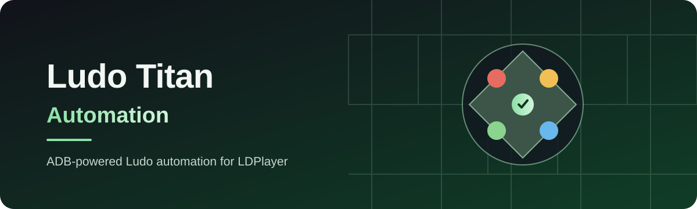
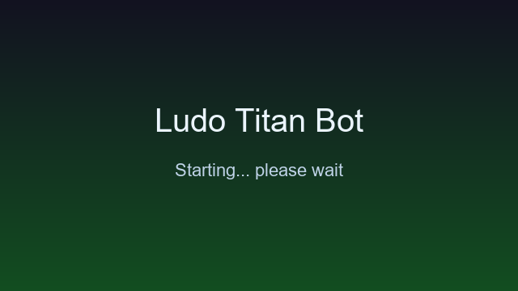
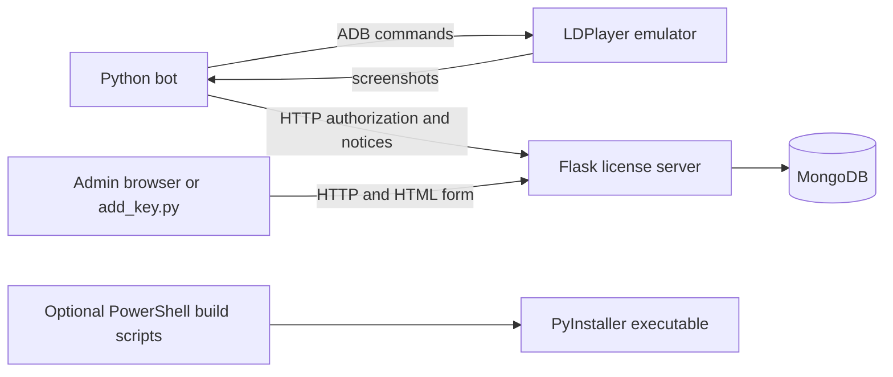

<p align="center"></p>

<div align="center">

# Ludo Titan Automation

Automate Ludo gameplay in an LDPlayer Android emulator with a Python bot that uses ADB, computer vision, and OCR. The repository also includes a Flask service for machine authorization and runtime notices.

[](https://github.com/Attayab-31/Ludo-Titan-Automation/stargazers)
[](https://github.com/Attayab-31/Ludo-Titan-Automation)
[](https://github.com/Attayab-31/Ludo-Titan-Automation/commits/main)

[Overview](#overview) · [Features](#features) · [Architecture](#system-architecture) · [Quickstart](#quickstart) · [API](#license-server-api) · [Security](#security-and-limitations) · [Contact](#contact-and-community)

[⭐ Star this repository](https://github.com/Attayab-31/Ludo-Titan-Automation)

[](https://twitter.com/intent/tweet?url=https%3A%2F%2Fgithub.com%2FAttayab-31%2FLudo-Titan-Automation&text=Ludo%20Titan%20Automation)
[](https://www.linkedin.com/sharing/share-offsite/?url=https%3A%2F%2Fgithub.com%2FAttayab-31%2FLudo-Titan-Automation)
[](https://www.facebook.com/sharer/sharer.php?u=https%3A%2F%2Fgithub.com%2FAttayab-31%2FLudo-Titan-Automation)
[](https://www.reddit.com/submit?url=https%3A%2F%2Fgithub.com%2FAttayab-31%2FLudo-Titan-Automation&title=Ludo%20Titan%20Automation)
[](https://api.whatsapp.com/send?text=Ludo%20Titan%20Automation%20https%3A%2F%2Fgithub.com%2FAttayab-31%2FLudo-Titan-Automation)

</div>

## Overview

Ludo Titan Automation is a Windows-oriented command-line bot for controlling Ludo through LDPlayer. It connects to Android Debug Bridge (ADB), reads emulator screenshots with OpenCV and EasyOCR, and can coordinate multiple configured devices. A separate Flask application provides MongoDB-backed authorization records, an admin page, disclaimer status, payment instructions, and pause controls.

The repository does not include a graphical desktop app, a hosted public demo, or a GitHub Actions test/security workflow. The license service is configured for deployment with Render, but deployment availability depends on external Render and MongoDB accounts.

## Features

- Connects to LDPlayer through ADB, with automatic path discovery and environment-variable overrides.
- Uses screenshot matching and OCR to automate the game interface.
- Supports a single device or multiple ADB serials with per-device club codes.
- Includes a Flask admin page and JSON endpoints backed by MongoDB.
- Includes optional Windows packaging scripts for building a PyInstaller executable and bundling EasyOCR model files.

## Screenshots or Demo

The repository includes the bot's startup splash image. This is an application asset, not a gameplay screenshot or a live demo.

<p align="center"></p>

## System Architecture



The bot talks to an existing emulator through ADB and calls a configured license-service URL. The Flask service reads configuration from its own `.env` file or process environment, then connects to MongoDB. The Render blueprint defines a web service rooted at `license_server/`.

## Technology Stack

| Area | Technologies |
| --- | --- |
| Automation | Python, pure-python-adb, OpenCV, EasyOCR, NumPy, Pillow, torchvision |
| Emulator bridge | LDPlayer and Android Debug Bridge |
| License service | Flask, Gunicorn, PyMongo, python-dotenv |
| Persistence | MongoDB |
| Optional packaging | PowerShell, PyInstaller |
| Hosting configuration | Render blueprint (`render.yaml`) |

## Project Structure

| Path | Purpose |
| --- | --- |
| `ludo_bot.py` | Main CLI automation bot and license/disclaimer client |
| `popup_template.png` | Image template loaded by the bot for popup detection |
| `splash.png` | Startup splash asset used by the executable build |
| `requirements.txt` | Bot Python dependencies |
| `license_server/app.py` | Flask routes, admin HTML, and MongoDB setup |
| `license_server/add_key.py` | Small JSON client for `POST /add_key` |
| `license_server/.env.example` | Safe configuration template for local service setup |
| `license_server/requirements.txt` | License service dependencies |
| `render.yaml` | Render service configuration |
| `build_exe.ps1` | Optional Windows PyInstaller build |
| `prepare_easyocr_models.ps1` | Downloads/copies EasyOCR model files for packaging |

## Quickstart

### Bot (Windows)

Prerequisites: Windows, Python 3.10 or later, LDPlayer, and an available ADB connection. The script targets a portrait emulator resolution of `1080x1920`; the default ADB serial is `127.0.0.1:5555`.

```powershell
python -m venv .venv
.\.venv\Scripts\Activate.ps1
python -m pip install -r requirements.txt
python ludo_bot.py --club '#bcaf9533'
```

For a specific device:

```powershell
python ludo_bot.py --serial 127.0.0.1:5555 --club '#bcaf9533'
```

Multi-device mode accepts comma- or space-separated serials and one club code (reused for all devices) or one club code per serial:

```powershell
python ludo_bot.py --serials '127.0.0.1:5555,127.0.0.1:5557' --clubs '#bcaf9533,#bcaf9533'
```

The bot checks the configured service at `https://ludo-bot-1zwp.onrender.com/validate` (set in `ludo_bot.py`) before automating. It calculates a machine ID from the computer's node name and OS. For ADB discovery, optional environment overrides include `ADB_PATH` or `ADB_BIN`, and `LDPLAYER_DIR`, `LDPLAYER_HOME`, or `LDPLAYER_PATH`. Android SDK discovery also checks `ANDROID_HOME` and `ANDROID_SDK_ROOT`.

### License server (local)

Create a MongoDB database and configure the required values in `license_server/.env`. The example uses placeholders and is not deployable as-is. Set strong, unique values for both secrets.

```powershell
Copy-Item license_server\.env.example license_server\.env
```

Edit the copied file, including a reachable MongoDB URI, then run:

```powershell
python -m venv .venv
.\.venv\Scripts\Activate.ps1
python -m pip install -r license_server\requirements.txt
$env:PORT = "5000"
python license_server\app.py
```

The server starts only when all required configuration is present and MongoDB is reachable. Its root endpoint at `http://localhost:5000/` returns a JSON endpoint list. The admin page is at `http://localhost:5000/admin`.

### Optional Windows executable

```powershell
.\build_exe.ps1
```

The script installs dependencies and PyInstaller, prepares EasyOCR model files, then builds `dist/LudoTitan.exe`. It may download model files on first use. The executable is a build artifact and is not tracked in this repository.

## License Server API

The Flask app initializes its MongoDB collections and indexes at import/startup. JSON request bodies are accepted on the listed POST endpoints; several also accept form fields. No API token scheme is used; admin JSON endpoints compare a supplied `secret` field with `ADMIN_SECRET`.

| Method and path | Request | Responses / behavior |
| --- | --- | --- |
| `GET /` | None | `200`; JSON service name and endpoint list |
| `GET /validate?machine_id=...` | Query parameter (the bot also sends `key`, which the route ignores) | `200 {"authorized":true,"message":"..."}` when a matching machine record exists; `403` for missing/unknown ID; `503 {"paused":true,"message":"..."}` when paused |
| `POST /add_machine` | `{"secret":"...","machine_id":"..."}` | `201 {"ok":true,"machine_id":"..."}`; `401`, `400`, or `409` on errors |
| `POST /add_key` | `{"secret":"...","key":"..."}` | `201 {"ok":true,"key":"..."}`; `401`, `400`, or `409` on errors |
| `POST /delete_machine` | `{"secret":"...","machine_id":"..."}` | Deletes a matching machine ID or key field; `200`, `401`, `400`, or `404` |
| `GET /disclaimer/status?machine_id=...` | Query parameter | `200 {"accepted":bool,"version":"...","text":"..."}`; `400` if missing ID |
| `POST /disclaimer/accept` | `{"machine_id":"...","version":"..."}` (version defaults to configured version) | `200 {"ok":true,"machine_id":"...","version":"..."}`; `400` if missing ID |
| `GET /payment_info` | None | `200 {"instructions":"...","url":"..."}` |
| `GET /ui_header` | None | `200 {"text":"...","lines":[...]}` |
| `GET /admin/status` | None | `200 {"paused":bool}`; public status |
| `POST /admin/pause`, `POST /admin/resume` | `{"secret":"..."}` | `200 {"ok":true,"paused":bool}` or `401` |
| `GET /admin` | Browser session | HTML login or admin interface |
| `POST /admin` | Form `action` plus fields | Login/logout, pause/resume, and machine management through the admin session |

<details>
<summary>License-server environment variables</summary>

All configuration is read by `license_server/app.py` from process environment and `license_server/.env`. `PORT` is required when starting the app directly; Render supplies it to Gunicorn.

| Variable | Required | Purpose |
| --- | --- | --- |
| `PORT` | Yes for `python app.py` | Flask development server port |
| `MONGO_URI` | Yes | MongoDB connection string |
| `MONGO_DB_NAME` | Yes | MongoDB database name |
| `ADMIN_SECRET` | Yes | Shared secret for administrative API actions and web login |
| `ADMIN_SESSION_SECRET` | Yes | Flask session signing secret |
| `MASTER_LICENSE_KEY` | Yes (may be empty) | Read by the service but not referenced by the current route logic |
| `PAUSED_MESSAGE` | Yes | Message returned while authorization is paused |
| `DISCLAIMER_VERSION` | Yes | Version recorded and checked for disclaimer acceptance |
| `DISCLAIMER_TEXT` | Yes (may be empty) | Disclaimer returned by the status endpoint |
| `PAYMENT_INSTRUCTIONS` | Yes | Payment text returned by `/payment_info` |
| `PAYMENT_URL` | Yes (may be empty) | Optional URL returned by `/payment_info` |
| `HEADER_TEXT` | Yes (may be empty) | Header text returned by `/ui_header` |

The sample `.env.example` includes non-secret placeholders. Replace them locally and do not commit `.env` or a real database URI.
</details>

<details>
<summary>Adding a license key</summary>

From `license_server/`, set `ADMIN_SECRET` and optionally `LICENSE_SERVER_URL`, then run:

```powershell
$env:ADMIN_SECRET = "your-admin-secret"
$env:LICENSE_SERVER_URL = "http://localhost:5000"
python add_key.py --key KAPTAAN-EXAMPLE
```

This writes a key record, but the current `/validate` implementation authorizes `machine_id` records only. Adding a key by itself does not authorize a bot machine; add the machine ID via the admin page or `POST /add_machine`.
</details>

## Testing and Build

There is no test suite or CI workflow in the repository. No test or security scan badge is shown. The optional executable build instructions are in the [Quickstart](#quickstart).

## Security and Limitations

- Keep `license_server/.env`, MongoDB credentials, and both admin secrets private. The example file contains placeholders only.
- The bot contacts a hard-coded external authorization service. Availability and behavior depend on that service and its MongoDB database.
- Machine IDs are derived from `platform.node()` and `platform.system()` and are not a hardware fingerprint.
- `/validate` currently ignores the `key` query parameter and checks registered machine IDs. The service also reads `MASTER_LICENSE_KEY` without using it in route logic.
- `/admin/status`, disclaimer, payment, and header endpoints are public. Admin endpoints use a shared secret; use HTTPS when deployed.
- This project automates a third-party game through an emulator. Users are responsible for complying with the game, emulator, and applicable service rules.
- The service's user-facing payment/disclaimer text is separate from the source-code rights defined in [`LICENSE`](LICENSE).

## Roadmap and License

The repository contains no published roadmap or tracked issue milestones. Suggested future work can be proposed in [GitHub Issues](https://github.com/Attayab-31/Ludo-Titan-Automation/issues).

**License:** Proprietary. See [`LICENSE`](LICENSE). No permission to copy, modify, or redistribute this source code is granted without prior written permission. Bot access or payment does not grant source-code rights. GitHub explains how a license communicates reuse permissions in its [license guidance](https://docs.github.com/en/communities/setting-up-your-project-for-healthy-contributions/adding-a-license-to-a-repository).

## Contact and Community

- **WhatsApp:** [+92 317 4026038](https://wa.me/923174026038)
- **Email:** [attayabpc2@gmail.com](mailto:attayabpc2@gmail.com)
- **LinkedIn:** [Muhammad Attayab Ashraf](https://pk.linkedin.com/in/muhammad-attayab-ashraf-519562262)
- **Freelancer:** [MuhammadAttayab](https://www.freelancer.com/u/MuhammadAttayab)
- **Issues and feature requests:** [GitHub Issues](https://github.com/Attayab-31/Ludo-Titan-Automation/issues)
- **Source and contributions:** [Repository](https://github.com/Attayab-31/Ludo-Titan-Automation)
- **Support the project:** [⭐ Star Ludo Titan Automation](https://github.com/Attayab-31/Ludo-Titan-Automation)
